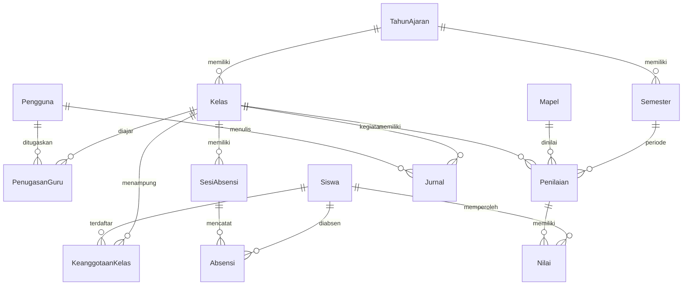

# Rancangan Google Sheets — skema v1 (tetap pada tahap 2)

Sumber kebenaran struktur adalah [`database/schema.json`](../database/schema.json). Build menghasilkan `00_Schema.gs` untuk inisialisasi dan validasi baca. Tahap 2 tidak mengubah nama tab, header, urutan kolom, atau versi. Tidak perlu menjalankan initializer ulang atau migrasi. Satu spreadsheet menyimpan satu sekolah. Nama tab dan urutan header harus persis; jangan menambah kolom di tengah tanpa merencanakan versi skema berikutnya.

## Tab dan relasi

| Tab | Kunci | Relasi dan tujuan |
| --- | --- | --- |
| Pengaturan | `key` | `value`, `description`; saat ini `school_name`, `semester_label` dibaca UI |
| Pengguna | `user_id` | Allowlist email unik, nama, role, aktif, waktu perubahan; tanpa password |
| TahunAjaran | `year_id` | Nama, tanggal mulai/selesai, aktif |
| Semester | `semester_id` | `year_id → TahunAjaran`, nama, periode, aktif |
| Kelas | `class_id` | `year_id → TahunAjaran`, `wali_user_id → Pengguna`, nama, tingkat, aktif |
| Siswa | `student_id` | Identitas stabil lintas tahun: NIS, NISN, nama, aktif, waktu perubahan |
| KeanggotaanKelas | `enrollment_id` | `student_id → Siswa`, `class_id → Kelas`, aktif; histori perpindahan tanpa mengganti ID siswa |
| Mapel | `subject_id` | Nama dan aktif |
| PenugasanGuru | `assignment_id` | `user_id → Pengguna`, `class_id → Kelas`, `subject_id → Mapel`, aktif |
| SesiAbsensi | `session_id` | `class_id → Kelas`, tanggal, jenis, `subject_id → Mapel` opsional, `created_by → Pengguna`, waktu |
| Absensi | `attendance_id` | `session_id → SesiAbsensi`, `student_id → Siswa`, status, catatan, `recorded_by → Pengguna`, waktu perubahan |
| Penilaian | `assessment_id` | Kelas, mapel, semester, nama, jenis, bobot, nilai maksimum, pembuat |
| Nilai | `grade_id` | `assessment_id → Penilaian`, `student_id → Siswa`, nilai, pengubah, waktu |
| Jurnal | `journal_id` | Kelas, mapel, tanggal, materi, catatan, `teacher_user_id → Pengguna`, waktu |
| AuditLog | `audit_id` | Aktor, tindakan, entitas, ID entitas, waktu; rencana audit perubahan |

## Tipe dan aturan yang dituju

- Semua ID: teks UUID stabil, unik, bukan nomor baris. Foreign key tidak boleh mengarah ke entitas yang hilang. Format sel ID/NIS/NISN sebagai **Plain text** sebelum memasukkan data.
- `aktif`: Boolean Sheets `TRUE/FALSE`; pembaca menerima boolean atau string `TRUE` tanpa membedakan kapital. String `FALSE` tidak dianggap aktif.
- `tanggal`, `tanggal_mulai`, `tanggal_selesai`: tanggal kalender ISO `YYYY-MM-DD`, atau sel tanggal Sheets. Pembaca mengubah objek tanggal menjadi ISO sesuai timezone proyek. Samakan timezone spreadsheet dan proyek.
- `created_at`, `updated_at`, `timestamp`: waktu ISO 8601 dengan offset. Tidak digunakan sebagai kata sandi atau tanda tangan audit.
- `role`: `ADMIN_KEPALA_SEKOLAH` atau `GURU`. Email pengguna unik setelah trim/lowercase. Guru mendapat cakupan kelas wali atau `PenugasanGuru` aktif.
- Pasangan keanggotaan siswa-kelas aktif harus unik. Satu kelas adalah rombel tahun tertentu; perpindahan menonaktifkan keanggotaan sebelumnya. Header saat ini belum menyimpan periode efektif perpindahan, sehingga rekonstruksi keanggotaan pada tanggal historis belum tersedia.
- `SesiAbsensi.jenis`: rancangan `HARIAN` atau `MAPEL`. Sesi harian unik per kelas-tanggal; sesi mapel kelak memerlukan aturan slot/jam sebelum mendukung beberapa pertemuan mapel yang sama sehari. Jangan membuat sesi ganda tanpa definisi ini.
- `Absensi.status`: `H` (hadir), `S` (sakit), `I` (izin), `A` (alfa). Unik per pasangan `(session_id, student_id)`.
- `Penilaian.jenis`: rancangan tugas, ulangan, ujian; `bobot > 0`, `nilai_maks > 0`, `0 <= Nilai.nilai <= nilai_maks`. Unik per `(assessment_id, student_id)`. Rumus leger dan kebijakan nilai kosong belum diimplementasikan.
- `catatan`, `materi`, nama: teks biasa. Penulisan nanti harus mencegah formula injection Sheets dan memvalidasi panjang, kepemilikan, serta tipe pada server.

**Sheets bukan database relasional.** Tahap 2 memvalidasi referensi tahun/wali/kelas/mapel pada mutasi, NIS unik termasuk siswa nonaktif, nama kelas unik per tahun, roster, sesi dan pasangan siswa-sesi, header, role, dan revision. Penulisan master dan absensi dicatat pada AuditLog. Data lama/manual tetap dapat melanggar skema; aplikasi menolak kondisi yang terdeteksi, bukan memperbaiki otomatis. Validasi semua relasi historis, periode semester, nilai, dan audit tahan manipulasi belum tersedia. Penjelasan mutasi dan penanganan kegagalan: [operasional.md](operasional.md).

## Definisi angka dashboard saat ini

- **Total Siswa:** siswa aktif unik dengan keanggotaan aktif dalam cakupan kelas aktif. Ini kondisi roster saat ini, bukan roster historis pada tanggal pilihan.
- **Data Kelas:** jumlah kelas aktif dalam cakupan pengguna/filter. Administrator mengelola penanda aktif lintas tahun; backend belum otomatis memilih tahun aktif dari tab TahunAjaran.
- **Kehadiran:** `jumlah H / jumlah catatan H+S+I+A × 100`, dibulatkan ke persen integer, pada tanggal pilihan. Tidak membagi dengan semua siswa terdaftar.
- **Sesi:** jumlah baris SesiAbsensi pada tanggal dan kelas pilihan, termasuk sesi yang belum mempunyai catatan.
- **Jurnal:** jumlah entri Jurnal pada tanggal dan kelas pilihan, dari semua pengajar dalam cakupan tersebut.
- **Grafik mingguan:** Senin–Minggu pada pekan tanggal pilihan, memakai rumus yang sama setiap hari.
- **Komposisi:** jumlah catatan siswa-sesi pada hari pilihan; siswa yang sama dapat dihitung dalam lebih dari satu sesi. Sesi harian dan mapel saat ini digabung. Ini bukan persentase siswa unik sekolah atau laporan kehadiran harian resmi.
- **Tanpa catatan:** persentase `null`, ditampilkan `—`; tidak dianggap 0% atau otomatis alfa. Siswa yang belum diabsen tidak masuk penyebut. Persentase kategori yang dibulatkan bisa berjumlah 99/101%.
- Ringkasan historis memakai catatan sesi dalam kelas yang saat ini dapat diakses. Pergantian role/penugasan dan histori keanggotaan belum memiliki rentang waktu akses tersendiri.

## Kapasitas dan langkah berikutnya

Pembacaan memakai `getValues()` per tab dan cache hanya di dalam satu request. Tidak ada cache identitas lintas pengguna. Untuk 100–500 siswa, master data kecil, tetapi catatan harian tumbuh (500 × 200 hari ≈ 100.000 baris per tahun sebelum sesi mapel). Pembaca saat ini masih memindai tab Absensi/Sesi/Jurnal penuh sebelum memfilter, dan belum diuji pada volume tersebut.

Sebelum pemakaian nyata: ukur kuota dan waktu Apps Script dengan data representatif, partisi/arsip absensi per tahun bila diperlukan, batasi rentang baca, paginasi daftar, rancang backup/retensi, serta kebijakan akses file. Mutasi tahap 2 menggunakan script lock, revision, penulisan bulk dan audit. Retry absensi dengan revision lama ditolak, bukan menghasilkan sesi baru. Kompensasi mencoba mengembalikan rentang bila penulisan gagal, tetapi tidak menjamin transaksi atomik lintas tab. Lock tidak menghalangi edit manual atau script lain. Pengujian lokal mencakup pagination dan penyimpanan roster 500 siswa; kuota/latensi layanan Google dan histori panjang belum diuji.
